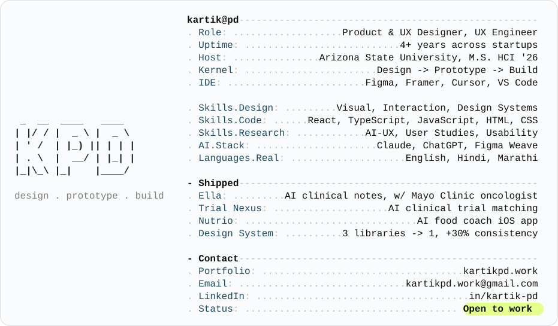

<!-- Profile card: swaps automatically with the viewer's GitHub theme -->
<a href="https://kartikpd.work">
  <picture>
    <source media="(prefers-color-scheme: dark)" srcset="dark_mode.svg">
    
  </picture>
</a>

  
  
  
  

## Hey, I'm Kartik PD 👋

I design, prototype and build products from the ground up. Product & UX designer, UX engineer and AI-UX researcher with 4+ years across startups, now focused on US health-tech.

I go from research to Figma to shipped code, using Claude and Cursor to close the gap between design and engineering.

---

## 🧭 What I Do

| Domain | Skills |
| --- | --- |
| Product & UX Design | Product strategy, user flows, interaction design, prototyping |
| Visual & Brand | Visual design, brand identity, marketing design, motion |
| Design Systems | Component libraries, tokens, docs for humans and AI agents |
| UX Research | User studies, usability testing, AI-UX research, synthesis |
| UX Engineering | React, TypeScript, HTML, CSS, AI-assisted design-to-code |
| Domains | Healthcare & clinical UX, accessibility, fintech, AI products |

---

## 🚀 Featured Work

| Project | What it is |
| --- | --- |
| **Ella** | AI clinical documentation tool built with a top Mayo Clinic oncologist. Designed and developed end to end with Claude and Cursor. |
| **[Trial Nexus](https://kartikpd.work/casestudy/trail-nexus)** | AI clinical trial matching platform. Design-led, AI-assisted build. Full case study on my portfolio. |
| **[Nutrio](https://kartikpd.work/casestudy/nutrio)** | AI food coach iOS app. Full case study on my portfolio. |
| **[Interaction Lab](https://kartikpd.work/interaction)** | UI micro-interactions I designed and coded, made to be played with. |

---

## 💼 Experience

**Client Projects, Arizona State University** · *2024 to 2026*
Mayo Clinic oncology AI features and the Education Assessment System, working directly with clinicians and educators on real problems.

**Product Designer, Goodgame Nation** · *Aug 2022 to Dec 2023*
Built the company's brand identity and designed product experiences.

**UX Designer, Defacto Technology** · *Nov 2020 to Aug 2022*
Merged 3 fintech product libraries (PocketBits, Zelta, CoinShots) into one design system, improving design consistency by 30%.

---

## 🛠️ Toolkit

**Design**

  
  
  

**Build**

  
  
  
  
  

**AI Workflow**

  
  
  
  

---

<i>Always up for a chat about health-tech, design systems or AI-UX. Thanks for stopping by ✌️</i>

